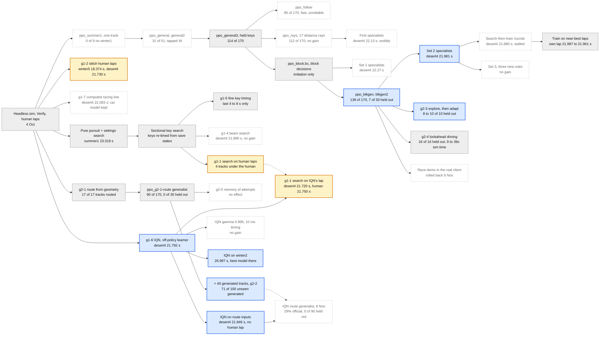

# Idea tree

Every approach tried in this project, joined to the one it was built on.
GitHub draws the diagram below from the text in this file, so to update it,
edit the text: add a node line, a `parent --> child` line, and a `class` line
for its status. Full details of each model are in
[`model-history.md`](model-history.md); the side ideas are in
[`../ideas/README.md`](../ideas/README.md).

Last updated 8 November 2026. Lap times are against the best human lap;
generalist scores are finishes out of 170 test attempts (10 per track, 17
tracks).

## Key

- **Blue**: in use, or the best of its kind.
- **Grey**: fed the next step.
- **White, dashed**: dropped, or no gain.
- **Gold**: a lap faster than the best human.

The dotted lines mark a second source: the better-than-human lap from IQN
used the g1-1 search on IQN's own lap, and the IQN route generalist trained
on g2-2's generated tracks.

## How to update it

1. Add a node: `id["Name best result"]` in its group.
2. Join it to what it was built on: `parent --> id`.
3. Add its id to one of the `class` lines at the bottom (`use`, `fed`,
   `drop` or `beat`), and move any node whose status changed.
4. Change the date at the top. Preview with GitHub's file view or any
   Mermaid previewer (for example the Markdown preview in VS Code).
